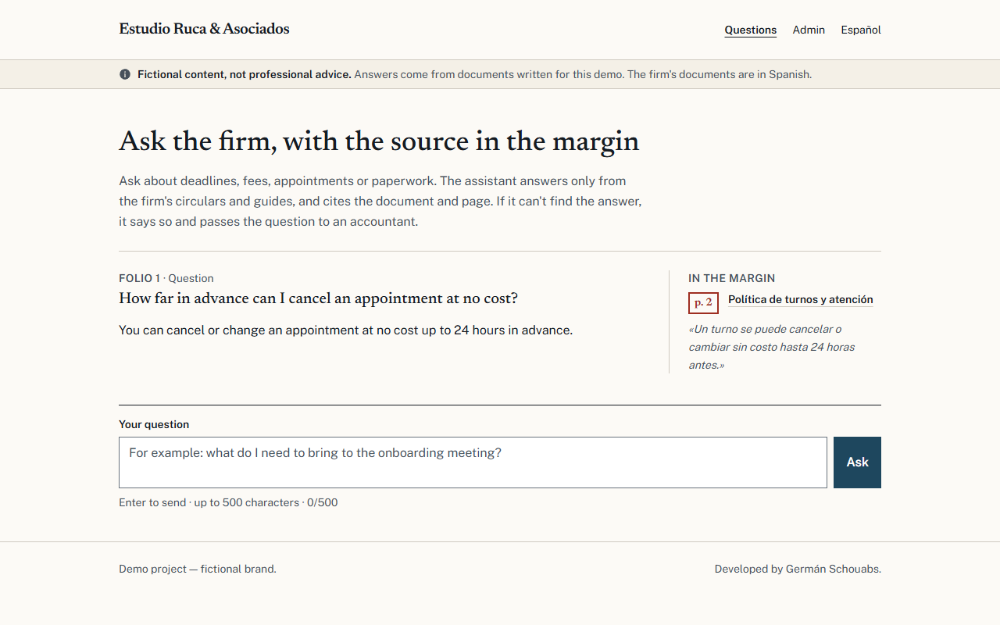
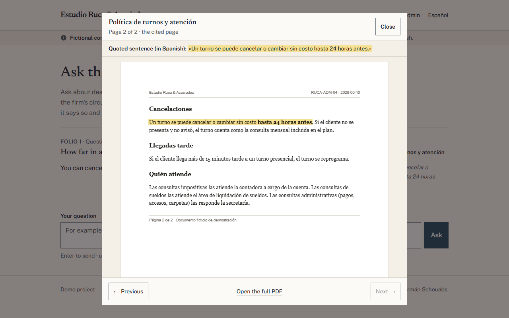
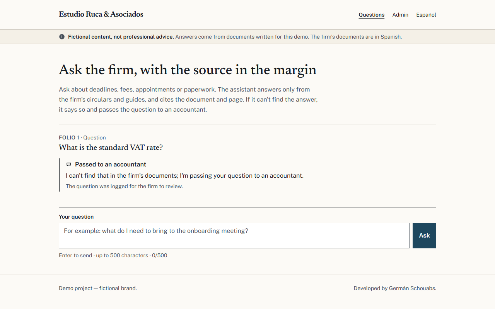
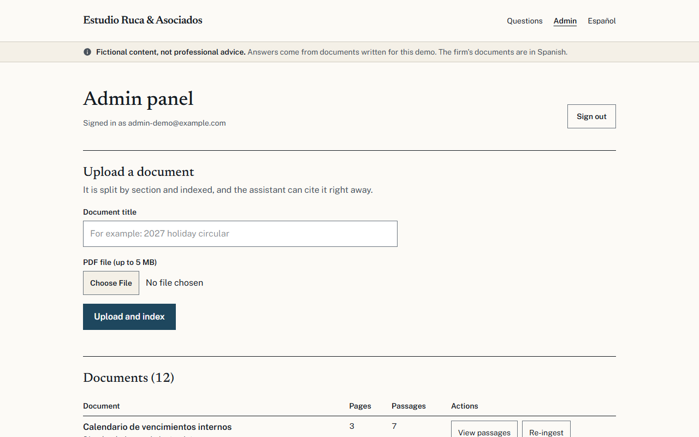
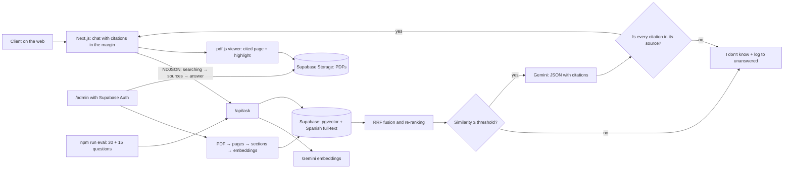

# Fojas · Assistant with citations for an accounting firm's documents

Answers client questions using only the firm's own documents, cites the document and page, and when it can't find the
answer it says so and passes the question to an accountant. · [Versión en español](README.md)


> **Demo project.** "Estudio Ruca & Asociados" is a fictional brand. Its 12 documents (circulars, guides and internal
> policies) are made up, in Spanish: they don't copy real regulations or amounts and **are not accounting advice**. It is
> not a real client. The interface has an English version (`/en`, `/en/admin`).

## The problem

A small accounting firm gets the same questions every month: the deadline for sending receipts, what a filing costs,
how to cancel an appointment, what to bring to onboarding. The answers are already written in the firm's circulars, but
nobody reads them, so someone at the firm keeps answering the same thing. A generic chatbot doesn't help: it makes
things up with confidence, and at an accounting firm a made-up answer (an amount, a deadline) is a real problem.

## The solution

- **Answers only from the firm's documents** and puts the source of each answer in the margin: document, page and the
  exact sentence. Clicking the citation opens the original PDF on that page with the sentence highlighted.
- **Says "I don't know"** when the documents don't cover it: it passes the question to an accountant and logs it, so the
  firm knows which document is missing.
- **Every citation is checked** against the document text before the answer is shown. If the model cites something that
  isn't there, the citation is dropped; if none is left, the answer is not shown.
- **Admin panel** (email and password): upload a new PDF (searchable within seconds), see how it was split, re-process
  it and review unanswered questions.
- **Automatic evaluation** with 30 golden questions (plus 15 in English) that measures correct citations, correct
  "I don't know" answers, hallucinations, latency and cost.

## Demo

- Live: https://fojas-psi.vercel.app/en (Spanish: https://fojas-psi.vercel.app). The admin panel requires the demo user.

| | |
|---|---|
|  |  |
|  |  |

## Architecture



- **Ingestion:** pdf.js reads each page with the font size of every line, so headings (larger) and letterhead and footer
  (smaller) are recognized regardless of how the PDF was built. Each section becomes a passage (long ones in overlapping
  windows). Each passage is hashed: re-ingesting never duplicates and only embeds what changed.
- **Hybrid search:** vector similarity (pgvector, HNSW) plus Spanish keyword search (`tsvector`, section titles weigh
  more), merged with Reciprocal Rank Fusion and re-ranked by term coverage.
- **Answer:** if nothing is similar enough, "I don't know" without calling the model. Otherwise Gemini gets numbered
  sources and returns JSON (answer, citations by source number, confidence), validated with Zod.
- **Streaming:** the chat shows which sources are being read while the model works, but the text only appears once its
  citations are validated. Word-by-word streaming would show sentences the validator might later reject.
- **English:** the assistant answers in English and quotes the Spanish source verbatim. Cross-language similarity is
  lower, so English questions use their own threshold (measured: 0.65 vs 0.70).

## Stack and skills

RAG with citations · Next.js 16 (App Router, server actions) · strict TypeScript · Tailwind 4 · Supabase (Postgres,
pgvector, full-text search, Storage, Auth, RLS) · Google Gemini (embeddings and structured output) · pdf.js · Zod ·
Vitest · Playwright · axe-core · Lighthouse.

## How to run it

```bash
npm install
cp .env.example .env.local      # fill in GEMINI_API_KEY, SUPABASE_URL and SUPABASE_SECRET_KEY
npm run check-env               # prints OK/MISSING per variable, never the values
```

1. In the Supabase SQL editor, run the two migrations in `supabase/migrations/` in order.
2. `npm run storage:preparar` creates the private bucket and uploads the 12 PDFs (in `data/corpus/pdf/`).
3. `npm run ingestar` splits and indexes the documents (69 passages; a second run does nothing).
4. `npm run admin:crear` creates the demo admin user; credentials go to `data/admin-demo.json` (not in git).
5. `npm run dev` → http://localhost:3203 (plus `/en`, `/admin`, `/en/admin`).

## Tests and measured results

| Check | Result |
|---|---|
| Spanish evaluation (`npm run eval`, 30 questions, real Supabase and Gemini) | Correct citations (document + page) **20/20 = 100%** · correct "I don't know" **10/10 = 100%** · **0 hallucinations** · 0 dropped citations |
| English evaluation (`npm run eval -- --idioma=en`, 15 questions on the Spanish documents) | Correct citations **10/10** · correct "I don't know" **5/5** · **0 hallucinations** |
| End-to-end latency (`--sin-cache`) | Spanish: p50 **1.7 s**, p95 2.5 s · English: p50 1.7 s, p95 6.4 s |
| Unit tests (`npm test`) | **55/55** (ingestion, search, citation checks, streaming, session, upload, highlight) |
| E2E (`npm run test:e2e`, Playwright against real Supabase and Gemini) | **18/18**: cited answer that opens the PDF, hand-off, uploading a PDF that turns "I don't know" into a cited answer, English |
| Accessibility (axe, WCAG 2.1 AA, mobile and desktop) | **0 violations** across 13 checks (chat, viewer, admin, English version) |
| Mobile Lighthouse (median of 3) on `/`, `/admin`, `/en`, `/en/admin` | **98 / 100 / 100 / 100** on all four |
| Corpus | 12 documents, 27 pages, 69 passages, 0 duplicates |

Of the 10 trick questions, 8 are stopped by similarity without calling the model; the 2 closest to the documents (the
firm's tax ID and its accounting software) are stopped by the model. Per-question detail in `docs/resultados/eval.json`
and `eval-en.json`.

## Estimated running costs

| Item | Cost |
|---|---|
| Gemini 3.5 Flash-Lite, paid tier (USD 0.30 / 1M input tokens, USD 2.50 / 1M output) + embeddings | **USD 0.00032 per question** (measured in the evaluation). Questions stopped by similarity only cost the embedding |
| Gemini, free tier | USD 0, with a daily request limit |
| Ingestion | 1 embedding per passage (69 for the whole corpus); re-ingesting unchanged files: 0 |
| Supabase and Vercel | USD 0 on their free plans at this volume |

## How to adapt it to your documents

1. Upload your PDFs from the admin panel (`/admin`) or put them in `data/corpus/pdf/` and run `npm run ingestar`. It works
   best with text PDFs (not scans) that have section headings.
2. Write 20–30 real questions with the document and page where the answer is, plus 10 your documents don't answer, in
   `data/eval/golden.json`. Run `npm run eval`.
3. If answerable questions get cut, lower the threshold (`--umbral=0.68` to try without touching the code); if trick
   questions get answered, raise it. Then set it in `src/rag/responder.ts`.
4. Change the firm's name and the prompt rules (`SISTEMA` in `src/rag/responder.ts`) and the texts in `src/i18n/textos.ts`.

## Limits and next steps

- The documents are fictional and the evaluation set is small (30 + 15 questions, written by the author of the
  documents): the numbers show the system works, not how it would do with a real firm's documents.
- English questions against Spanish documents have lower similarity, so they use their own threshold (0.65 vs 0.70).
- Rate limits (10 per minute per IP, 60 overall) live in each instance's memory; in production they would go to shared
  storage.
- Scanned PDFs would need OCR before ingestion.
- Next steps: conversation history, WhatsApp answers with the same engine and a usage dashboard.

## Authorship

Developed by Germán Schouabs.

## License

MIT. See [LICENSE](LICENSE).
