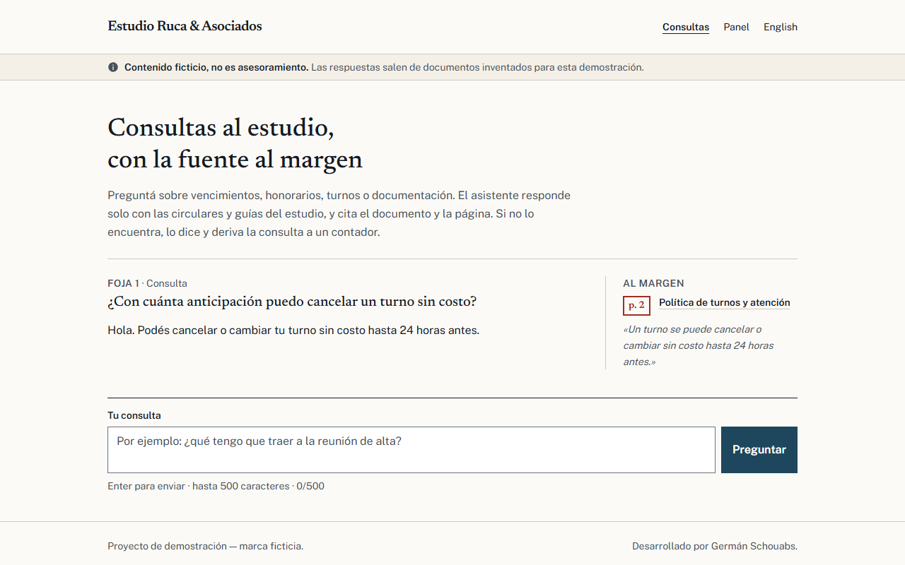
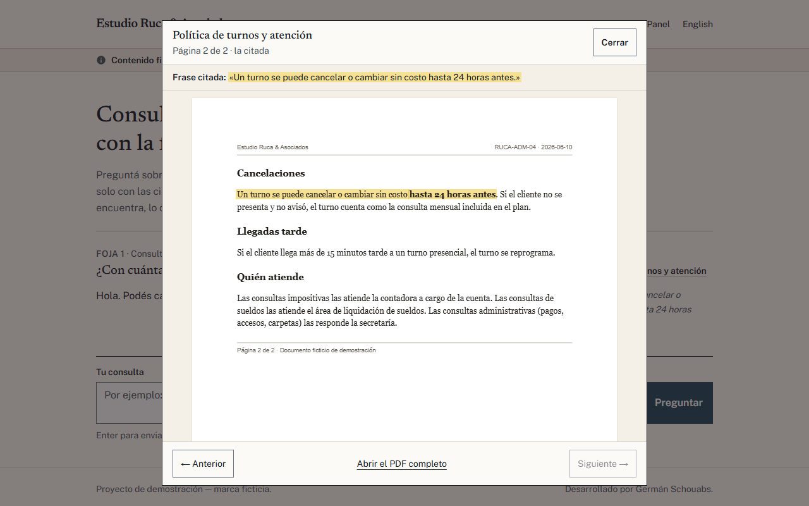
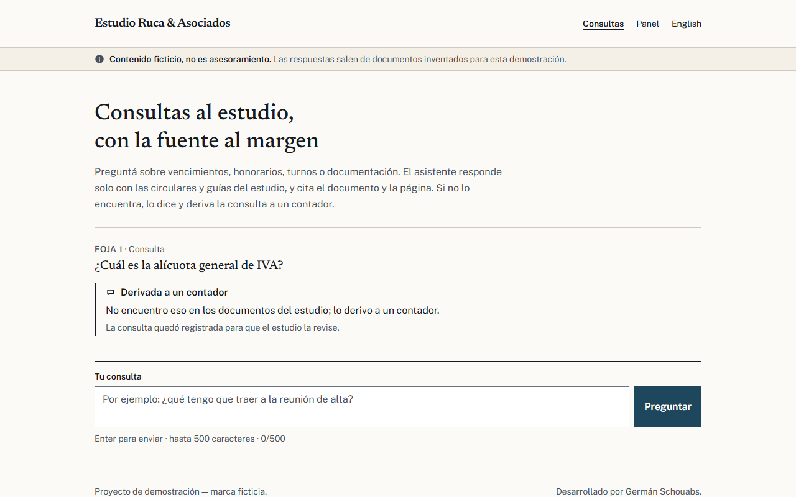
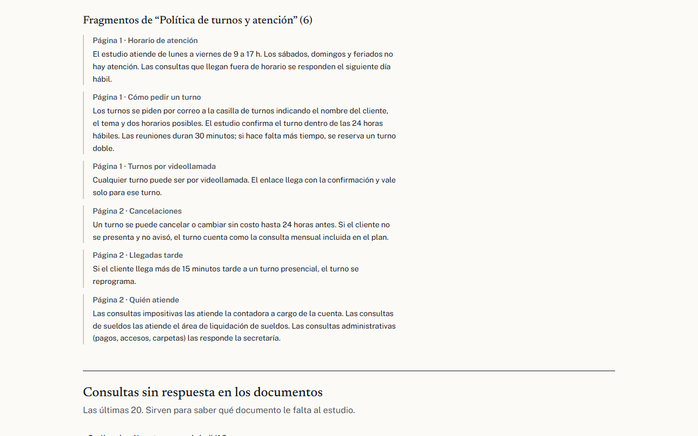
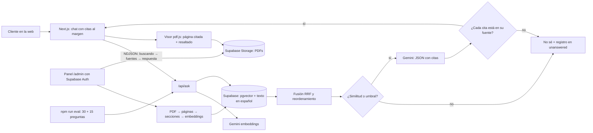

# Fojas · Asistente con citas para los documentos de un estudio contable

Responde las consultas de los clientes solo con los documentos del estudio, cita el documento y la página, y cuando no
encuentra la respuesta lo dice y la deriva a un contador. · [English version](README.en.md)


> **Proyecto de demostración.** "Estudio Ruca & Asociados" es una marca ficticia. Los 12 documentos (circulares,
> guías y políticas internas) son inventados: no copian normativa ni montos reales y **no son asesoramiento contable**.
> No es un cliente real. La interfaz tiene versión en inglés (`/en`, `/en/admin`).

## El problema

Un estudio contable chico recibe todos los meses las mismas preguntas: hasta qué día se mandan los comprobantes, cuánto
sale un trámite, cómo se cancela un turno, qué hay que traer al alta. Las respuestas ya están escritas en sus circulares,
pero nadie las lee y alguien del estudio contesta lo mismo una y otra vez. Un chatbot común no sirve: inventa con
seguridad, y en un estudio contable una respuesta inventada (un monto, un plazo) es un problema serio.

## La solución

- **Responde solo desde los documentos del estudio** y pone al margen la fuente de cada respuesta: documento, página y
  la frase exacta. Al tocar la cita se abre el PDF original en esa página con la frase resaltada.
- **Dice "no lo sé"** cuando los documentos no lo cubren: deriva a un contador y deja la consulta registrada para que el
  estudio sepa qué documento le falta.
- **Cada cita se verifica** contra el texto del documento antes de mostrar la respuesta. Si el modelo cita algo que no
  está, la cita se descarta; si no queda ninguna, la respuesta no sale.
- **Panel del estudio** (con usuario y contraseña): subir un PDF nuevo (queda consultable en segundos), ver cómo se
  dividió, volver a procesarlo y revisar las consultas sin respuesta.
- **Evaluación automática** con 30 preguntas doradas (y 15 en inglés), que mide citas correctas, "no sé" correctos,
  alucinaciones, latencia y costo.

## Demo

- En vivo: https://fojas-psi.vercel.app (en inglés: https://fojas-psi.vercel.app/en). El panel pide el usuario de demostración.

| | |
|---|---|
|  |  |
|  |  |

Capturas en inglés en [`docs/capturas/en/`](docs/capturas/en/).

## Arquitectura



- **Ingesta:** pdf.js lee cada página con el tamaño de letra de cada línea; así se reconocen los títulos (más grandes) y
  el membrete y el pie (más chicos) sin depender de cómo se armó el PDF. Cada sección es un fragmento (si es larga, en
  ventanas con solapamiento). Hash por fragmento: reingestar no duplica y solo pide embeddings de lo que cambió.
- **Búsqueda híbrida:** similitud de vectores (pgvector, HNSW) y búsqueda por palabras en español (`tsvector`, el título
  de la sección pesa más), mezcladas con Reciprocal Rank Fusion y reordenadas por cobertura de términos.
- **Respuesta:** si nada se parece lo suficiente, "no sé" sin gastar el modelo. Si no, Gemini recibe las fuentes
  numeradas y devuelve JSON (respuesta, citas por número de fuente, confianza), validado con Zod.
- **Streaming:** el chat muestra qué fuentes se están leyendo mientras el modelo trabaja, pero el texto aparece recién
  con las citas validadas. Un streaming palabra por palabra mostraría frases que después el validador podría descartar.

## Stack y skills demostradas

RAG con citas · Next.js 16 (App Router, server actions) · TypeScript estricto · Tailwind 4 · Supabase (Postgres,
pgvector, búsqueda de texto, Storage, Auth, RLS) · Google Gemini (embeddings y salida estructurada) · pdf.js · Zod ·
Vitest · Playwright · axe-core · Lighthouse.

## Cómo correrlo

```bash
npm install
cp .env.example .env.local      # completar GEMINI_API_KEY, SUPABASE_URL y SUPABASE_SECRET_KEY
npm run check-env               # dice OK/FALTA por variable, sin mostrar valores
```

1. En el editor SQL de Supabase, correr las dos migraciones de `supabase/migrations/` en orden.
2. `npm run storage:preparar` crea el bucket privado y sube los 12 PDFs (están en `data/corpus/pdf/`).
3. `npm run ingestar` divide e indexa los documentos (69 fragmentos; la segunda vez no hace nada).
4. `npm run admin:crear` crea el usuario de demo del panel; las credenciales quedan en `data/admin-demo.json` (fuera de git).
5. `npm run dev` → http://localhost:3203 (y `/en`, `/admin`, `/en/admin`).

Los documentos de ejemplo se regeneran desde Markdown con `npm run corpus:pdf`.

## Tests y resultados medidos

| Prueba | Resultado |
|---|---|
| Evaluación en español (`npm run eval`, 30 preguntas, Supabase y Gemini reales) | Citas correctas (documento + página) **20/20 = 100 %** · "no sé" correcto **10/10 = 100 %** · **0 alucinaciones** · 0 citas descartadas |
| Evaluación en inglés (`npm run eval -- --idioma=en`, 15 preguntas sobre los documentos en español) | Citas correctas **10/10** · "no sé" correcto **5/5** · **0 alucinaciones** |
| Latencia de punta a punta (`--sin-cache`) | Español: p50 **1,7 s**, p95 2,5 s · Inglés: p50 1,7 s, p95 6,4 s |
| Tests de unidad (`npm test`) | **55/55** (ingesta, búsqueda, validación de citas, streaming, sesión, subida, resaltado) |
| e2e (`npm run test:e2e`, Playwright contra Supabase y Gemini reales) | **18/18**: respuesta con cita que abre el PDF, derivación, subir un PDF que pasa de "no sé" a respuesta citada, inglés |
| Accesibilidad (axe, WCAG 2.1 AA, celular y compu) | **0 violaciones** en 13 revisiones (chat, visor, panel, versión en inglés) |
| Lighthouse móvil (mediana de 3) en `/`, `/admin`, `/en`, `/en/admin` | **98 / 100 / 100 / 100** en las cuatro |
| Corpus | 12 documentos, 27 páginas, 69 fragmentos, 0 duplicados |

De las 10 preguntas trampa, 8 se cortan por similitud sin llamar al modelo; las 2 que se parecen más a los documentos
(el CUIT del estudio y el sistema contable) las frena el modelo. Detalle por pregunta en `docs/resultados/eval.json` y
`eval-en.json`.

## Costos de operación estimados

| Concepto | Costo |
|---|---|
| Gemini 3.5 Flash-Lite, plan pago (USD 0,30 / 1M tokens de entrada, USD 2,50 / 1M de salida) + embeddings | **USD 0,00032 por pregunta** (medido en la evaluación). Las que se cortan por similitud cuestan solo el embedding |
| Gemini, plan gratis | USD 0, con límite diario de pedidos |
| Ingesta | 1 embedding por fragmento (69 para el corpus completo); reingestar sin cambios: 0 |
| Supabase y Vercel | USD 0 en sus planes gratuitos para este volumen |

## Cómo adaptarlo a tus documentos

1. Subí tus PDFs desde el panel (`/admin`) o dejalos en `data/corpus/pdf/` y corré `npm run ingestar`. Funciona mejor con
   PDFs de texto (no escaneados) que tengan títulos de sección.
2. Escribí 20 o 30 preguntas reales con el documento y la página donde está la respuesta, y otras 10 que tus documentos
   no respondan, en `data/eval/golden.json`. Corré `npm run eval`.
3. Si se cortan preguntas que sí tienen respuesta, bajá el umbral (`--umbral=0.68` para probar sin tocar el código); si
   se responden trampas, subilo. Después fijalo en `src/rag/responder.ts`.
4. Cambiá el nombre del estudio y las reglas del prompt (`SISTEMA` en `src/rag/responder.ts`) y los textos de
   `src/i18n/textos.ts`.

## Límites y próximos pasos

- Los documentos son ficticios y el set de evaluación es chico (30 + 15 preguntas, escritas por quien armó los
  documentos): los números muestran que el sistema funciona, no cómo le iría con los documentos de un estudio real.
- En inglés la similitud con documentos en español es más baja: usa un umbral propio (0,65 contra 0,70).
- Los límites de pedidos (10 por minuto por IP, 60 en total) viven en la memoria de cada instancia; en producción
  irían en un almacenamiento compartido.
- PDFs escaneados necesitarían OCR antes de la ingesta.
- Próximos pasos: historial de conversación, respuestas por WhatsApp con el mismo motor y un panel con métricas de uso.

## Autoría

Desarrollado por Germán Schouabs.

## Licencia

MIT. Ver [LICENSE](LICENSE).
